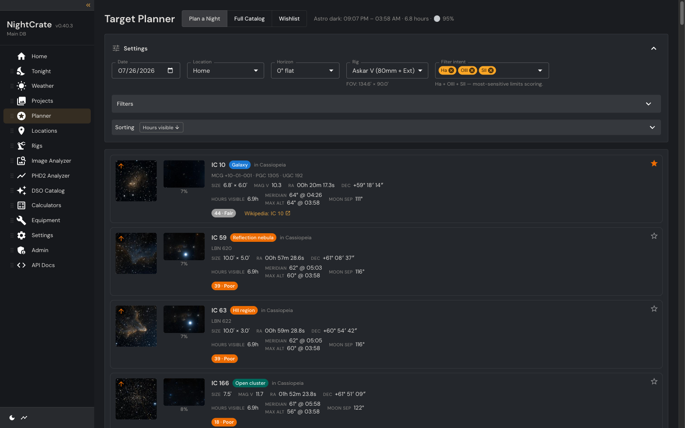
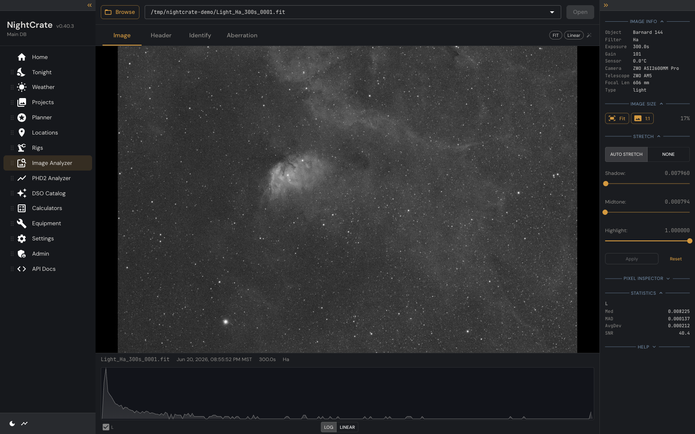

# NightCrate

A free, local application for astrophotographers to plan nights, catalog imaging
projects, and inspect their data. NightCrate connects the files and logs produced
by capture software with the context needed to review and process them.

No account or telemetry. Catalogs and image processing stay on your machine;
forecasts and survey imagery are fetched from external services when needed.



## Features

- **Projects and catalog:** bind folders or archives, classify captures from
  headers, tag rigs/targets, inspect frames in a table grouped by night (or as
  thumbnails), keep notes and finished images.
  Files stay where they are. Rescanning updates the catalog without duplicating
  records within a project. Files a scan couldn't catalog, such as a damaged
  XISF, are listed with the reason under "Not cataloged". A project can start with a finished image and manual
  sessions; importing raw captures is optional. Plate solving a project image
  identifies the catalog objects in it, and you choose one or more as main
  targets. Each project has a status (Active, Paused, Complete, Abandoned)
  that you set from its title, and a "Plate solved" pill that opens its
  Plate Solve tab. A plate-solved project's Info tab lists its targets with
  their catalog numbers, constellation, distance and Wikipedia links, every
  other catalogued object in the picture, nearest first, and the
  constellation at the picture's centre. A sky chart shows that
  constellation's stars and stick figures, with the picture marked, and the
  date the picture's centre is on the meridian at midnight. Opened full
  screen, it pans and zooms, from the whole sky in to your own picture
  drawn in place at its plate-solved size and rotation, and names the
  brighter stars (the IAU names, more of them as you zoom in).
  - The plate-solve result estimates the focal length from the solved scale
    and the pixel size of each rig's camera, beside the rig's own value.
  - **Thumbnails:** frame each picture as you want it shown, separately for
    small, medium and large views. Every frame is 4:3 and may extend onto a
    black mat, so a tall image can have black at its sides.
  - **Setups:** each rig on a project opens its full setup (telescope,
    camera, image scale, field of view, filters, mount, guiding, computer,
    software), side by side with any earlier setup the project used. A
    project can change a rig for itself only, for example a guide scope
    instead of the rig's off-axis guider.
  - **Software:** list the programs used on a project, each with a version
    if you want one.
- **Gallery:** every project's picture, as you framed it or whole, in a list
  or small, medium or large grids.
  - Search for an object by name or designation, with suggestions as you
    type. "M1" finds M 1, not M 10. Optionally include every object in each
    plate-solved image: results say whether the object is a main target or
    in the picture, and show the plate-solved picture with the object
    marked.
  - Filter by catalog, object type, constellation, status, rig and imaging
    dates. Sort by latest or first imaging date, or by name.
  - Click an image to turn its card over: the targets' Messier and NGC
    numbers and Wikipedia links, their constellation, and their distance in
    light-years (or range of distances), on a distance ruler from 100
    light-years to 10 billion that also places the other catalogued objects
    in a plate-solved picture. Below them are
    the imaging months and nights, total integration, rigs and status. The
    list view shows the same. Expand any image to full size and step through
    the results with the arrow keys or by swiping; while the slideshow is
    paused, click or tap the picture to turn it over to the same details.
  - Play a slideshow from the full-size view, on a computer, tablet or
    phone. ↑ and ↓ (or − and +) lengthen or shorten the time per picture,
    which is remembered. ← and → still step without stopping it. The
    Messier page's full-size view has it too.
- **Messier checklist:** all 110 objects, each showing your own image when a
  project has one, or a sky-survey picture marked "Not imaged" until you
  image it. A small map of the 110 shows your progress; click a box to jump
  to its object. Objects not yet imaged that appear in one of your
  plate-solved pictures are marked.
  - Options: the projects under each picture, a rig's whole view on the
    sky-survey pictures with how much of the field the object fills, and
    which objects never rise at a chosen location.
  - Several projects on one object: arrows step through their images.
- **Sessions and integration:** enter capture batches manually or derive them
  from cataloged lights. Batches are grouped by night with each night's rig,
  setup and filter mix, and a note per night that survives rebuilding. View
  totals by filter and observing night, and sub counts by filter and
  exposure length. Duoband equipment-filter sessions count
  toward each passed line and once toward total exposure time. Subs whose
  files name no filter show as "Not recorded", and the Files tab can list
  them on their own.
- **Frame quality:** batch HFR, star count, star SNR, and background measurements,
  with progress, cancellation, and sorting to find frames worth inspecting.
- **Planning:** date/location/horizon-aware visibility, rig framing, filter-aware
  target scores, sky tracks, annual visibility, wishlists and calendars.
  Objects that are already a project's target carry a pill that opens it.
- **Deep-sky catalogs:** OpenNGC (Messier, NGC, IC and Caldwell) is always
  loaded. Sharpless 2, Barnard, LBN, LDN, Melotte, Arp, ACO galaxy clusters,
  MCG, Herbig-Haro objects, Wolf-Rayet stars, planetary nebulae and Abell
  planetary nebulae (both from HASH) are optional: add or remove each in
  Admin's Catalogs section. An entry that names an existing object becomes
  another name for it, and searching for an entry that covers several
  objects, such as Arp 244 or the Cygnus Loop, finds each of them. Objects
  carry their common names, from the catalogs and from NightCrate's own
  reviewed list: every name is searchable, one is shown, and hovering a
  result's name shows the others. The catalog and planner panels link to
  SIMBAD, Wikipedia, Google search and Google Images.
- **Image analysis:** FITS, XISF (including PixInsight 1.9.6's compressed,
  checksummed files and the plate solutions it stores), PixInsight projects,
  PNG/JPEG/TIFF and archive entries; auto/manual stretch, histogram, pixel inspection, FITS header editing,
  aberration inspection, built-in plate solving (Gaia DR3 stars, offline after a
  one-time download), with ASTAP optional, and catalog-object overlays. Either
  solver searches near the header position first and then the whole sky.
- **Guiding:** standalone PHD2 log analysis with time-series and dispersion plots,
  section/selection statistics, calibration geometry and range export.
- **Equipment:** editable component catalog, personal rigs and smart-scope
  presets, filter loadouts, imaging and guiding calculators.
  - Changing the equipment on a rig you've used asks whether to apply the
    change to existing projects (fixing a mistake) or only from now on (a
    real change). From now on, older projects keep the setup they were shot
    with, and a night can be moved to another setup by hand.
  - Editing a camera, telescope or other record says how many rigs and
    projects use it. Programs can hold their versions.
- **Weather:** a personal Go / Uncertain / No verdict for each of the next 14
  nights (the second week shown as an outlook). It uses imaging rules saved
  per location:
  - a total-cloud ceiling;
  - a maximum precipitation chance, an amount threshold, and an optional
    check of every model's amount;
  - optional wind, dew and Moon limits.

  You choose which cloud forecasts count (ECMWF, GFS, ICON); by default each
  hour follows the majority, or disagreement can be shown as Uncertain.
  Each night has per-night gear and imaging times and an hour-by-hour
  breakdown against those limits. See
  [weather algorithms](docs/weather-algorithms.md).
- **Reference tools:** DSO catalog, locations/custom horizons, astronomy
  calculators, Tonight summary, API documentation and activity console.



## Status

Active development. Folder ingestion, derived sessions and frame measurements
are implemented. Calibration coverage UI, guiding association with exposures,
capture-log/autofocus integration and a unified session timeline are planned.
The app has no packaged native installer yet.

Equipment is assigned through declared rigs and folder tags; automatic FITS
equipment inference and integration goals were removed. Derived sessions update
on request. Mixing manual and derived records for the same captures can currently
inflate totals.

See [the active plan](PLAN.md) for remaining work and the
[documentation index](docs/README.md) for code locations and technical references.

## Run locally

Prerequisites: Python 3.14, [uv](https://docs.astral.sh/uv/), Node 22.12+.
[ASTAP](https://www.hnsky.org/astap.htm) is an optional alternative plate solver
and uses its separately installed star database. Intel Macs also need Xcode
Command Line Tools for source-built dependencies (`xcode-select --install`).

```bash
make install    # install backend/frontend dependencies from the lockfiles
make dev        # backend :8000, frontend :5173
```

The setup wizard creates or opens a workspace containing `nightcrate.db` and
rendered `project_data/`. Source images remain in their original locations;
copying a workspace does not copy that source library. Admin manages multiple
workspaces and downloads the DSO catalogs. For built-in plate solving, Admin can
download the stars once (1.14 GB; about 2–3.5 GB on disk, depending on whether
the optional narrow-field index is built). Catalog updates keep your wishlist, project targets and
solved-field objects; an object a catalog no longer lists stays in your records,
marked "Not listed". Removing an optional catalog deletes the objects only it
provides, except those on your wishlist or a project's targets, which stay
marked "Not listed". The catalog choice applies to every workspace.

Other commands: `make backend`, `make frontend`, `make test`, `make test-fast`,
`make lint`, `make format`. Use `make dev BROWSER=none` to suppress browser launch
or `make dev LOG=DEBUG` for diagnostic logs. On macOS, `make dev` opens Brave
unless `BROWSER` names another browser; elsewhere it opens the default browser.
Developer checks and conventions are in [CLAUDE.md](CLAUDE.md).

## Stack

Python/FastAPI/Pydantic, SQLite with raw SQL and yoyo migrations; React/TypeScript,
Vite, MUI Community, Zustand, TanStack Query and D3. Astronomy and image work use
astropy, numpy/scipy and sep. Optional mlx (Apple Silicon) or CuPy (CUDA) accelerates
supported operations; numpy is the fallback. Platform paths support Mac, Windows
and Linux.

## Access model

NightCrate trusts the local user and has no authentication. Normal `make dev`
binds the backend to localhost. The file browser can access paths permitted to
the process; this is not a shared or publicly hosted service.

`make dev-lan` enables HTTPS tablet access on a trusted LAN and exposes **both**
servers on the network, with permissive backend CORS. Do not use it on an
untrusted/shared network. Vite uses `frontend/.certs/{cert,key}.pem` if available,
otherwise a self-signed certificate. Never commit certificates or databases.

## License

Copyright (C) 2026 Fred Baptiste.

NightCrate is free software: you can redistribute it and/or modify it under the
terms of the [GNU General Public License](LICENSE) as published by the Free
Software Foundation, either version 3 of the License, or (at your option) any
later version. It is distributed in the hope that it will be useful, but
WITHOUT ANY WARRANTY; without even the implied warranty of MERCHANTABILITY or
FITNESS FOR A PARTICULAR PURPOSE. See the license for details.

Earlier releases keep the licence they were released under: v0.3.0a–v0.10.1
GPL-3.0, v0.12.0–v0.41.10 MIT. NightCrate's own catalog data in
`backend/src/nightcrate/data/catalogs/nightcrate/` has the same licence as the
code from v0.45.0; through v0.44.0 it was MIT.
Dependency and data-source acknowledgments follow.

## Open Source Acknowledgments

Libraries and data sources used by NightCrate:

### Backend (Python)

| Library | License | Copyright |
|---|---|---|
| [NumPy](https://numpy.org/) | BSD 3-Clause | Copyright (c) 2005-2025, NumPy Developers |
| [SciPy](https://scipy.org/) | BSD 3-Clause | Copyright (c) 2001-2025, SciPy Developers |
| [Astropy](https://www.astropy.org/) | BSD 3-Clause | Copyright (c) 2011-2025, Astropy Developers |
| [Pillow](https://python-pillow.org/) | MIT-CMU (PIL License) | Copyright (c) 1997-2011 by Secret Labs AB; Copyright (c) 1995-2011 by Fredrik Lundh; Copyright (c) 2010-2025 by Jeffrey A. Clark and contributors |
| [FastAPI](https://fastapi.tiangolo.com/) | MIT | Copyright (c) 2018 Sebastián Ramírez |
| [Uvicorn](https://www.uvicorn.org/) | BSD 3-Clause | Copyright (c) 2017-present, Encode OSS Ltd |
| [Pydantic](https://docs.pydantic.dev/) | MIT | Copyright (c) 2017-2025, Samuel Colvin and Pydantic Contributors |
| [httpx](https://www.python-httpx.org/) | BSD 3-Clause | Copyright (c) 2019, Encode OSS Ltd |
| [aiosqlite](https://github.com/omnilib/aiosqlite) | MIT | Copyright (c) Amethyst Reese |
| [yoyo-migrations](https://ollycope.com/software/yoyo/) | Apache 2.0 | Copyright (c) Oliver Mayfield-Sherborne |
| [aiofiles](https://github.com/Tinche/aiofiles) | Apache 2.0 | Copyright (c) Tin Tvrtković |
| [python-multipart](https://github.com/Kludex/python-multipart) | Apache 2.0 | Copyright (c) 2012-2013 Andrew Dunham |
| [platformdirs](https://github.com/tox-dev/platformdirs) | MIT | Copyright (c) platformdirs contributors |
| [lz4](https://github.com/python-lz4/python-lz4) | BSD 3-Clause | Copyright (c) 2012-2023, Jonathan Underwood |
| [zstandard](https://github.com/indygreg/python-zstandard) | BSD 3-Clause | Copyright (c) 2016-present, Gregory Szorc |
| [defusedxml](https://github.com/tiran/defusedxml) | PSF-2.0 | Copyright (c) 2013-2023, Christian Heimes |
| [tifffile](https://github.com/cgohlke/tifffile) | BSD 3-Clause | Copyright (c) 2008-2026, Christoph Gohlke |
| [imagecodecs](https://github.com/cgohlke/imagecodecs) | BSD 3-Clause | Copyright (c) 2008-2026, Christoph Gohlke |
| [bottleneck](https://github.com/pydata/bottleneck) | BSD 2-Clause | Copyright (c) 2010-2019, Keith Goodman |
| [sep](https://github.com/kbarbary/sep) | LGPL-3.0-or-later | Copyright (c) 2014, Kyle Barbary |
| [py7zr](https://github.com/miurahr/py7zr) | LGPL-2.1+ | Copyright (c) 2019-2025, Hiroshi Miura |
| [mlx](https://github.com/ml-explore/mlx) | MIT | Copyright (c) 2023-2026, Apple Inc. |
| [timezonefinder](https://github.com/jannikmi/timezonefinder) | MIT | Copyright (c) 2016-2026, Jannik Michelfeit |
| [tzdata](https://github.com/python/tzdata) | Apache 2.0 (IANA time zone data: public domain) | Copyright (c) 2020, Paul Ganssle (Google); Copyright (c) 2026, Stan Ulbrych |
| [astropy-healpix](https://github.com/astropy/astropy-healpix) | BSD 3-Clause | Copyright (c) Astropy Developers |

### Frontend (TypeScript / React)

| Library | License | Copyright |
|---|---|---|
| [React](https://react.dev/) | MIT | Copyright (c) Meta Platforms, Inc. and affiliates |
| [MUI](https://mui.com/) (Material UI + X Community) | MIT | Copyright (c) MUI |
| [Emotion](https://emotion.sh/) (@emotion/react, @emotion/styled) | MIT | Copyright (c) Emotion team and other contributors |
| [D3.js](https://d3js.org/) | ISC | Copyright (c) 2010-2025, Michael Bostock |
| [Zustand](https://github.com/pmndrs/zustand) | MIT | Copyright (c) 2019 Paul Henschel |
| [TanStack Query](https://tanstack.com/query) | MIT | Copyright (c) 2021-present Tanner Linsley |
| [React Router](https://reactrouter.com/) | MIT | Copyright (c) React Training LLC 2015-2019; Copyright (c) Remix Software Inc. 2020-2021; Copyright (c) Shopify Inc. 2022-2023 |
| [dnd kit](https://dndkit.com/) (@dnd-kit/core, @dnd-kit/sortable, @dnd-kit/utilities) | MIT | Copyright (c) 2021, Claudéric Demers |
| [KaTeX](https://katex.org/) | MIT | Copyright (c) 2013-2020 Khan Academy and other contributors |
| [react-markdown](https://github.com/remarkjs/react-markdown) | MIT | Copyright (c) Espen Hovlandsdal |
| [remark-gfm](https://github.com/remarkjs/remark-gfm) | MIT | Copyright (c) Titus Wormer |
| [Vite](https://vite.dev/) | MIT | Copyright (c) 2019-present, VoidZero Inc. and Vite contributors |
| [Geist Font](https://vercel.com/font) | SIL OFL 1.1 | Copyright (c) 2023 Vercel |

### External Programs

Invoked across a process boundary; their licenses do not propagate to NightCrate.

| Program | License | Notes |
|---|---|---|
| [ASTAP](https://www.hnsky.org/astap.htm) | MPL-2.0 (main program; some files LGPL-3.0+ or GPL-2.0+) | Optional alternative plate solver, invoked via subprocess. Not bundled. |

### Data Sources

| Dataset | License | Attribution |
|---|---|---|
| [Siril Astrometry Catalogue extracted from Gaia DR3](https://doi.org/10.5281/zenodo.14692304) | CC BY 4.0 | Prepared by the Siril team. Downloaded at runtime from Zenodo into the user's app-data folder and not bundled. The Gaia data is also under ESA's CC BY-NC 3.0 IGO terms; NightCrate makes no claim that it may be used commercially. |
| [ESA Gaia DR3](https://www.cosmos.esa.int/gaia) | CC BY-NC 3.0 IGO | This work has made use of data from the European Space Agency (ESA) mission Gaia (https://www.cosmos.esa.int/gaia), processed by the Gaia Data Processing and Analysis Consortium (DPAC, https://www.cosmos.esa.int/web/gaia/dpac/consortium). Funding for the DPAC has been provided by national institutions, in particular the institutions participating in the Gaia Multilateral Agreement. |
| [OpenNGC](https://github.com/mattiaverga/OpenNGC) | CC-BY-SA-4.0 | Verga, Mattia. OpenNGC — Database of NGC and IC objects. Fetched at runtime from GitHub into the user's app-data folder (`APP_DIR/catalogs/openngc/`); no catalog data is bundled with the repo. OpenNGC aggregates data from NED, SIMBAD, HyperLEDA, and other public astronomical databases. |
| [VizieR](https://vizier.cds.unistra.fr) | CDS public | This research has made use of the VizieR catalogue access tool, CDS, Strasbourg, France (DOI: 10.26093/cds/vizier). The catalogs below that name a VizieR table are optional. Each is downloaded at runtime at the user's request, from CDS Strasbourg or one of its mirrors (Harvard and IDIA South Africa over HTTPS; Tokyo, Beijing and India over plain HTTP as a fallback), into the user's app-data folder (`APP_DIR/catalogs/vizier/`); none is bundled. |
| Sharpless 2 (VizieR VII/20) | CDS public | Sharpless, S. 1959, ApJS 4, 257. HII regions. |
| Barnard (VizieR VII/220A) | CDS public | Barnard, E. E. 1927, *Barnard's Catalogue of 349 Dark Objects in the Sky*. |
| LBN (VizieR VII/9) | CDS public | Lynds, B.T. 1965 — Catalogue of Bright Nebulae, Astrophysical Journal Supplement Series 12, 163 (VizieR VII/9). |
| LDN (VizieR VII/7A) | CDS public | Lynds, B.T. 1962 — Catalogue of Dark Nebulae, Astrophysical Journal Supplement Series 7, 1 (VizieR VII/7A). |
| ACO (VizieR VII/110A) | CDS public | Abell, G.O., Corwin, H.G. Jr. & Olowin, R.P. 1989 — A Catalogue of Rich Clusters of Galaxies, Astrophysical Journal Supplement Series 70, 1 (VizieR VII/110A). |
| MCG (VizieR VII/62A, VII/100) | CDS public | Vorontsov-Velyaminov, B.A., Krasnogorskaya, A.A. & Arkhipova, V.P. 1962–1974 — Morphological Catalogue of Galaxies, volumes 1–5 (VizieR VII/62A, VII/100). |
| Arp (VizieR VII/192) | CDS public | Arp, H. 1966 — Atlas of Peculiar Galaxies; Webb, D. 1996 — Arp's Peculiar Galaxies index (VizieR VII/192). |
| Herbig-Haro objects (VizieR V/104) | CDS public | Reipurth, B.: 1999, A general catalogue of Herbig-Haro objects, 2. edition, http://casa.colorado.edu/hhcat (VizieR V/104). |
| Wolf-Rayet stars (VizieR III/215) | CDS public | van der Hucht, K.A. 2001 — The Seventh Catalogue of Galactic Wolf-Rayet stars, New Astronomy Reviews 45, 135 (VizieR III/215). |
| HASH PN database (VizieR V/163) | CDS public; HASH asks for this citation and acknowledgement | Parker, Q.A., Bojičić, I.S. & Frew, D.J. 2016 — HASH: the Hong Kong/AAO/Strasbourg Hα planetary nebula database, Journal of Physics: Conference Series 728, 032008. This research has made use of the HASH PN database at hashpn.space (VizieR V/163). One download serves both the planetary nebula and the Abell planetary nebula catalogs. The Abell catalog covers 85 of the 86 Abell numbers; Abell 85 (CTB 1) is a supernova remnant. |
| Melotte | GPL-3.0-or-later (NightCrate's own list) | Melotte 1915, MmRAS 60, 175 (A Catalogue of Star Clusters shown on Franklin-Adams Chart Plates), transcribed and checked by NightCrate. Positions and sizes of clusters without an NGC or IC number: Hunt & Reffert 2023, A&A 673, A114, or SIMBAD. Ships with the app (`melotte.csv`). |
| NightCrate editorial data | GPL-3.0-or-later | NightCrate's own reviewed lists ship with the app in `backend/src/nightcrate/data/catalogs/nightcrate/`: common names (each checked against two independent sources, among them SIMBAD, NED, Wikidata or Wikipedia, and NASA, ESA, ESO, NOIRLab and RASC publications), distances and surface brightness, Sharpless cross-references, external-reference overrides, the Melotte list, reviewed Arp members, the "part of" list and match overrides. |
| Star cluster and planetary nebula distances | Published facts, cited per row | Distances in NightCrate's `dso_augment.csv` for Messier and Caldwell objects: Baumgardt, H. & Vasiliev, E. 2021, MNRAS 505, 5957 (globular clusters, Gaia EDR3); Hunt, E.L. & Reffert, S. 2023, A&A 673, A114 (open clusters, Gaia DR3; VizieR J/A+A/673/A114); González-Santamaría, I. et al. 2021, A&A 656, A51, and Chornay, N. & Walton, N.A. 2021, A&A 656, A110 (planetary nebulae, Gaia EDR3). A few objects cite their own papers in the file's notes. Compiled into NightCrate's file; nothing is fetched. |
| [d3-celestial](https://github.com/ofrohn/d3-celestial) sky data | BSD-3-Clause | Copyright (c) 2015, Olaf Frohn. The sky chart's constellation stick figures and name positions, from d3-celestial 0.7.35's data files. The sky chart's data is converted by `backend/scripts/build_sky_data.py` and ships with the app in `frontend/src/data/sky/`, with `LICENSE-d3-celestial.txt` and `SOURCES.md`. The converted `sky.json` is CC BY-SA 4.0, because it adapts the HYG and Stellarium data below. |
| [HYG database](https://codeberg.org/astronexus/hyg) v4.4 | CC BY-SA 4.0 ([licence](https://creativecommons.org/licenses/by-sa/4.0/)) | David Nash, [The Astronomy Nexus](https://www.astronexus.com/hyg). The sky chart's star positions and magnitudes, to magnitude 6, plus Mira for the Cetus figure; rounded, with stars at the same position merged. HYG's positions come from ESA's Hipparcos mission. Credit: ESA (ESA 1997, *The Hipparcos and Tycho Catalogues*, ESA SP-1200). |
| Constellation boundaries ([Stellarium](https://github.com/Stellarium/stellarium) modern sky culture) | CC BY-SA 4.0 ([licence](https://creativecommons.org/licenses/by-sa/4.0/)) | Stellarium contributors. The IAU constellation boundaries in B1875 coordinates, from Patrick Barbier's `edges_18`. Precessed to J2000 for the sky chart, then sampled and simplified so the drawn lines stay within 6″ of the true boundaries. |
| [IAU Catalog of Star Names](https://exopla.net/star-names/modern-iau-star-names/) | Names in the public domain (IAU WGSN); the catalogue file is released under Creative Commons Attribution | IAU Working Group on Star Names. The sky chart's star names, for named stars to magnitude 3.5, matched by Hipparcos number. |
| IAU constellation figures | CC BY 4.0 ([licence](https://creativecommons.org/licenses/by/4.0/)) | IAU and Sky & Telescope magazine (Roger Sinnott & Rick Fienberg), with patterns by Alan MacRobert. The sky chart's stick figures, through d3-celestial, with line modifications by Olaf Frohn and converted for NightCrate (rounded, joined to stars). |
| [50 MGC](https://github.com/davidohlson/50MGC) | CDS public | Ohlson, D. et al. 2024, AJ 167, 31 (J/AJ/167/31). Galaxy distance augmenter, fetched at runtime from the author's GitHub mirror. |
| [Wikidata](https://www.wikidata.org/) | CC0-1.0 | External reference IDs (Wikipedia, SIMBAD) via SPARQL, fetched at runtime. |
| [Open-Meteo](https://open-meteo.com/) | Attribution required — see [their license](https://open-meteo.com/en/license) | Weather, ECMWF and air-quality forecast data, queried at runtime. |
| [DSS2 colour HiPS (CDS)](https://alasky.cds.unistra.fr/DSS/DSSColor) | CDS terms | Digitized Sky Survey imagery (STScI/NASA; colour HiPS by CDS), fetched at runtime as HiPS tiles from CDS (alasky) or ESA's ESASky mirror and cached locally. |

### Methods and prior work

The built-in plate solver uses 4-star geometric hashing and Bayesian verification
following Lang et al. (2010, *AJ* 139, 1782), and the TAN projection described by
Calabretta & Greisen (2002). The design was informed by the open-source
[Seti Astro Suite Pro](https://github.com/SetiAstro/setiastrosuitepro) (GPL-3.0)
and [astrometry.net](https://github.com/dstndstn/astrometry.net) (GPL-3).
NightCrate's implementation is its own and copies no code from either project.
